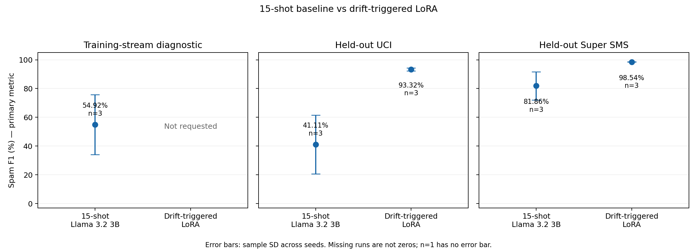

# Concept drift benchmark

No inference is performed by the default report command.

Comparison: 15-shot Llama 3.2 3B versus the team's drift-triggered LoRA. **Spam F1 is primary.**
Three detector families: ADWIN; statistical KS/PSI (two variants); embedding MMD. KS and PSI are not counted as separate families.

The evaluated stream uses a stepwise gradual transition. Windows 1-5 contain only UCI; windows 6-9 contain 10%, 25%, 50%, and 75% Super SMS; windows 10-14 contain only Super SMS. Each window contains 200 messages. The four mixed-source windows span 800 messages, and their source counts match the saved manifest. No separate abrupt-versus-gradual or transition-width comparison is included.

Spam is positive. Invalid outputs count as incorrect; spam abstentions count as false negatives.
Confusion matrix rows: ham, spam; columns: ham, spam, invalid. Metrics are recomputed from predictions.

FPR = false positives / all actual ham (including invalid ham). PR-AUC is trapezoidal area under the precision-recall curve from continuous spam scores, not average precision; label-only runs report N/A with a reason.

## Coverage

| Method | Seed | Stream | UCI test | Super SMS test |
|---|---:|---|---|---|
| baseline | 29822 | complete (2800/2800) | complete (1031/1031) | complete (2000/2000) |
| baseline | 29823 | complete (2800/2800) | complete (1031/1031) | complete (2000/2000) |
| baseline | 29824 | complete (2800/2800) | complete (1031/1031) | complete (2000/2000) |
| drift_triggered_lora | 29822 | not_requested (0/0) | complete (1031/1031) | complete (2000/2000) |
| drift_triggered_lora | 29823 | not_requested (0/0) | complete (1031/1031) | complete (2000/2000) |
| drift_triggered_lora | 29824 | not_requested (0/0) | complete (1031/1031) | complete (2000/2000) |

## Completed populations by seed

Percentages, including PR-AUC x 100. A completed held-out model seed requires both UCI and Super SMS; individual completed populations remain visible below. Stream diagnostics are independent.

| Method | Seed | Population | Spam F1 (primary) | Accuracy | Precision | Spam recall | FPR | PR-AUC |
|---|---:|---|---:|---:|---:|---:|---:|---:|
| baseline | 29822 | stream | 40.38 | 40.96 | 25.32 | 99.64 | 73.48 | N/A: Label-only run: no continuous spam scores |
| baseline | 29822 | uci_test | 27.59 | 34.82 | 16.00 | 100.00 | 74.42 | N/A: Label-only run: no continuous spam scores |
| baseline | 29822 | super_sms_test | 74.29 | 65.40 | 59.10 | 100.00 | 69.20 | N/A: Label-only run: no continuous spam scores |
| baseline | 29823 | stream | 45.61 | 53.00 | 29.69 | 98.39 | 58.26 | N/A: Label-only run: no continuous spam scores |
| baseline | 29823 | uci_test | 31.20 | 45.30 | 18.51 | 99.22 | 61.90 | N/A: Label-only run: no continuous spam scores |
| baseline | 29823 | super_sms_test | 78.45 | 72.90 | 65.19 | 98.50 | 52.60 | N/A: Label-only run: no continuous spam scores |
| baseline | 29824 | stream | 78.77 | 89.86 | 67.74 | 94.11 | 11.21 | N/A: Label-only run: no continuous spam scores |
| baseline | 29824 | uci_test | 64.53 | 87.10 | 48.99 | 94.53 | 13.95 | N/A: Label-only run: no continuous spam scores |
| baseline | 29824 | super_sms_test | 92.84 | 92.80 | 92.38 | 93.30 | 7.70 | N/A: Label-only run: no continuous spam scores |
| drift_triggered_lora | 29822 | uci_test | 94.21 | 98.55 | 93.13 | 95.31 | 1.00 | 96.49 |
| drift_triggered_lora | 29822 | super_sms_test | 98.70 | 98.70 | 98.99 | 98.40 | 1.00 | 99.91 |
| drift_triggered_lora | 29823 | uci_test | 92.25 | 98.06 | 91.54 | 92.97 | 1.22 | 94.96 |
| drift_triggered_lora | 29823 | super_sms_test | 98.55 | 98.55 | 98.79 | 98.30 | 1.20 | 99.85 |
| drift_triggered_lora | 29824 | uci_test | 93.50 | 98.45 | 97.46 | 89.84 | 0.33 | 96.04 |
| drift_triggered_lora | 29824 | super_sms_test | 98.38 | 98.40 | 99.79 | 97.00 | 0.20 | 99.90 |

## Benchmark table with error bars

Mean +/- sample SD across completed model seeds for held-out populations; stream seeds are counted separately. Values are percentages and SD is in percentage points. SD is N/A for n=1. PR-AUC reports its own scored-seed count; label-only runs have no invented scores.

| Model | Population | Completed seeds | Spam F1 (primary) | Accuracy | Precision | Spam recall | FPR | PR-AUC |
|---|---|---|---:|---:|---:|---:|---:|---:|
| 15-shot Llama 3.2 3B | stream | 29822,29823,29824 (3/3) | 54.92 +/- 20.82; n=3 | 61.27 +/- 25.47; n=3 | 40.91 +/- 23.33; n=3 | 97.38 +/- 2.90; n=3 | 47.65 +/- 32.47; n=3 | N/A (n=0): Label-only run: no continuous spam scores |
| Drift-triggered LoRA | stream | none (0/3) | Not requested | Not requested | Not requested | Not requested | Not requested | Not requested |
| 15-shot Llama 3.2 3B | uci_test | 29822,29823,29824 (3/3) | 41.11 +/- 20.37; n=3 | 55.74 +/- 27.66; n=3 | 27.83 +/- 18.36; n=3 | 97.92 +/- 2.96; n=3 | 50.09 +/- 31.92; n=3 | N/A (n=0): Label-only run: no continuous spam scores |
| Drift-triggered LoRA | uci_test | 29822,29823,29824 (3/3) | 93.32 +/- 0.99; n=3 | 98.35 +/- 0.26; n=3 | 94.04 +/- 3.06; n=3 | 92.71 +/- 2.74; n=3 | 0.85 +/- 0.46; n=3 | 95.83 +/- 0.79; n=3 |
| 15-shot Llama 3.2 3B | super_sms_test | 29822,29823,29824 (3/3) | 81.86 +/- 9.73; n=3 | 77.03 +/- 14.16; n=3 | 72.22 +/- 17.72; n=3 | 97.27 +/- 3.52; n=3 | 43.17 +/- 31.82; n=3 | N/A (n=0): Label-only run: no continuous spam scores |
| Drift-triggered LoRA | super_sms_test | 29822,29823,29824 (3/3) | 98.54 +/- 0.16; n=3 | 98.55 +/- 0.15; n=3 | 99.19 +/- 0.53; n=3 | 97.90 +/- 0.78; n=3 | 0.80 +/- 0.53; n=3 | 99.89 +/- 0.03; n=3 |

## Held-out adaptation outcomes

Super SMS measures post-drift generalization; UCI measures original-domain retention. Delta is relative to the same-seed baseline. Retention is 100 x adapted F1 / baseline F1 (uncapped). N/A means predictions or a nonzero baseline denominator are unavailable.

| Method | Seed | Complete model / paired seed | Super SMS F1 (%) | Change from baseline (pp) | UCI F1 retention (%) |
|---|---:|---|---:|---:|---:|
| baseline | 29822 | True / True | 74.29 | 0.00 | 100.00 |
| baseline | 29823 | True / True | 78.45 | 0.00 | 100.00 |
| baseline | 29824 | True / True | 92.84 | 0.00 | 100.00 |
| drift_triggered_lora | 29822 | True / True | 98.70 | 24.40 | 341.51 |
| drift_triggered_lora | 29823 | True / True | 98.55 | 20.09 | 295.63 |
| drift_triggered_lora | 29824 | True / True | 98.38 | 5.54 | 144.88 |

| Method | Outcome | Mean +/- sample SD; completed seeds |
|---|---|---|
| baseline | super_sms_f1 | 81.86 +/- 9.73; n=3 |
| baseline | super_sms_f1_change_pp | 0.00 +/- 0.00; n=3 |
| baseline | uci_f1_retention_pct | 100.00 +/- 0.00; n=3 |
| drift_triggered_lora | super_sms_f1 | 98.54 +/- 0.16; n=3 |
| drift_triggered_lora | super_sms_f1_change_pp | 16.68 +/- 9.88; n=3 |
| drift_triggered_lora | uci_f1_retention_pct | 260.67 +/- 102.87; n=3 |

## Time, memory, and adapter resources

Inference is scoped to each population. Training, peak memory, adapter size, and cost describe the shared run named by measurement_scope in resources.csv; repeated cells must not be summed. N/A means not measured, except the baseline has no training or trainable parameters and no adapter. Hardware differs across historical runs; wall time is not GPU time.

| Method | Seed | Population / status | Training (s) | Inference (s) | Peak memory (MB) | Measured accelerator (h) | Cost | Trainable parameters | Adapter (MB) |
|---|---:|---|---:|---:|---:|---:|---|---:|---:|
| baseline | 29822 | stream / complete | 0.00 | 6887.54 | N/A | N/A | N/A | 0 | N/A |
| baseline | 29822 | uci_test / complete | 0.00 | 2501.42 | N/A | N/A | N/A | 0 | N/A |
| baseline | 29822 | super_sms_test / complete | 0.00 | 4749.77 | N/A | N/A | N/A | 0 | N/A |
| baseline | 29823 | stream / complete | 0.00 | 6620.73 | N/A | N/A | N/A | 0 | N/A |
| baseline | 29823 | uci_test / complete | 0.00 | 2484.78 | N/A | N/A | N/A | 0 | N/A |
| baseline | 29823 | super_sms_test / complete | 0.00 | 4913.99 | N/A | N/A | N/A | 0 | N/A |
| baseline | 29824 | stream / complete | 0.00 | 6773.39 | N/A | N/A | N/A | 0 | N/A |
| baseline | 29824 | uci_test / complete | 0.00 | 2476.83 | N/A | N/A | N/A | 0 | N/A |
| baseline | 29824 | super_sms_test / complete | 0.00 | 4797.37 | N/A | N/A | N/A | 0 | N/A |
| drift_triggered_lora | 29822 | uci_test / complete | 107.85 | 13.68 | 6520.42 | N/A | N/A | 24,320,000 | 46.51 |
| drift_triggered_lora | 29822 | super_sms_test / complete | 107.85 | 26.60 | 6520.42 | N/A | N/A | 24,320,000 | 46.51 |
| drift_triggered_lora | 29823 | uci_test / complete | 103.77 | 12.69 | 6523.25 | N/A | N/A | 24,320,000 | 46.51 |
| drift_triggered_lora | 29823 | super_sms_test / complete | 103.77 | 25.42 | 6523.25 | N/A | N/A | 24,320,000 | 46.51 |
| drift_triggered_lora | 29824 | uci_test / complete | 105.01 | 13.41 | 6522.35 | N/A | N/A | 24,320,000 | 46.51 |
| drift_triggered_lora | 29824 | super_sms_test / complete | 105.01 | 25.90 | 6522.35 | N/A | N/A | 24,320,000 | 46.51 |

Resource mean/sample SD and measurement counts are exported to resource_summary.csv, grouped by method, population, hardware, and currency. Held-out aggregates require complete model seeds; stream diagnostics remain separate. Missing measurements have n=0.

## Existing seed-29822 held-out results: verification pending

These are team-reported historical results, excluded from audited tables and error bars. Count arithmetic can be checked against current class totals; message membership, scores, and execution provenance require the original artifacts. PR-AUC below is reported, not independently recomputed.

| Method | Population | Arithmetic | Verification status | Spam F1 (primary) | Accuracy | Precision | Spam recall | FPR | PR-AUC |
|---|---|---|---|---:|---:|---:|---:|---:|---:|
| baseline | uci_test | PASS | needs_prediction_artifacts | 49.21 | 74.98 | 32.98 | 96.88 | 27.91 | N/A: no continuous-score artifacts |
| baseline | super_sms_test | PASS | needs_prediction_artifacts | 87.48 | 86.05 | 79.33 | 97.50 | 25.40 | N/A: no continuous-score artifacts |
| drift_triggered_lora | uci_test | PASS | needs_prediction_artifacts | 93.98 | 98.55 | 96.69 | 91.41 | 0.44 | 98.23 |
| drift_triggered_lora | super_sms_test | PASS | needs_prediction_artifacts | 98.63 | 98.65 | 99.90 | 97.40 | 0.10 | 99.91 |

Historical summary arithmetic only: drift_triggered_lora Super SMS F1 change **+11.15 pp**; UCI F1 retention **190.98%**. These are not accepted paired benchmark results; protocol alignment remains unresolved.

| Historical method | Population | Reported training (s) | Reported inference (s) | Peak memory (MB) | Trainable parameters | Adapter (MB) |
|---|---|---:|---:|---:|---:|---:|
| baseline | uci_test | 0.00 | 380.42 | N/A | 0.00 | N/A |
| baseline | super_sms_test | 0.00 | 679.48 | N/A | 0.00 | N/A |
| drift_triggered_lora | uci_test | 725.37 | 46.39 | 7057.69 | 24320000.00 | 46.51 |
| drift_triggered_lora | super_sms_test | 725.37 | 184.09 | 7057.69 | 24320000.00 | 46.51 |

- baseline / uci_test: `8ac3bedfe207dfbe21fc76ba2afbf4c32e540aec:results/baseline_full/metrics.json`.
  Required original predictions: `results/baseline_full/uci_predictions.csv`.
  Historical held-out prompt examples differ from the current stream-excluding prompt. Align the held-out protocol before combining seeds.

- baseline / super_sms_test: `8ac3bedfe207dfbe21fc76ba2afbf4c32e540aec:results/baseline_full/metrics.json`.
  Required original predictions: `results/baseline_full/super_sms_predictions.csv`.
  Historical held-out prompt examples differ from the current stream-excluding prompt. Align the held-out protocol before combining seeds.

- drift_triggered_lora / uci_test: `8ac3bedfe207dfbe21fc76ba2afbf4c32e540aec:results/lora_fine_tuning/metrics.json`.
  Required original predictions: `results/lora_fine_tuning/uci_test_predictions.csv`.
  Historical trigger: Embedding MMD (RBF) at position 1201. This used the legacy detector protocol; it is not equivalent to the current calibration/alert-timing protocol.
  Training/validation ID lists and source hashes are not present in the summary; the zero-leakage claim cannot be independently confirmed.
  The recorded run commit lacks train_lora.py; confirm the exact executed trainer source.

- drift_triggered_lora / super_sms_test: `8ac3bedfe207dfbe21fc76ba2afbf4c32e540aec:results/lora_fine_tuning/metrics.json`.
  Required original predictions: `results/lora_fine_tuning/super_sms_test_predictions.csv`.
  Historical trigger: Embedding MMD (RBF) at position 1201. This used the legacy detector protocol; it is not equivalent to the current calibration/alert-timing protocol.
  Training/validation ID lists and source hashes are not present in the summary; the zero-leakage claim cannot be independently confirmed.
  The recorded run commit lacks train_lora.py; confirm the exact executed trainer source.

Retrieve the existing predictions, continuous LoRA scores, exact executed trainer, training/validation IDs, input/model hashes, and trigger provenance before deciding whether seed 29822 needs a repeat. Historical baseline prompt examples and LoRA trigger protocol differ from this benchmark. All detailed checks and source hashes are in historical_audit.json.

## Reused evidence

- baseline / 29822 / stream: complete (2800/2800); `D:\DATA298A_Harness\seed_29822\predictions.csv`. Evaluated through the same run-config and prediction checks as local inputs.

The external stream is read-only. Held-out UCI and Super SMS files are resolved independently from the local run directory. Detector results are recomputed with this benchmark's calibration protocol; historical detector summaries are not imported.
Legacy stream metadata identifies model tag and examples but not the original model digest; do not infer byte-identical historical weights from a matching tag.

## Detection, retention, and compute

Detector results are in detector_metrics.csv and detectors/. Calibration uses early pre-drift windows; those windows are excluded from false-alarm denominators. Window alerts occur at window end. Missing detections retain null delay and detected=false.

paired_comparisons.csv compares the same seed and held-out examples. Retention is after/before x 100 (uncapped); zero baseline denominators produce null. Changes are percentage points.

compute.csv keeps training, evaluation, and measured accelerator-hours separate. Missing measurements remain null; inference wall time is never renamed GPU-hours.

## Limitations

The UCI-to-Super-SMS stream simulates dataset shift, not verified chronological concept drift. First-five-window false-alarm exposure is small after excluding calibration. The project ADWIN implementation is approximate; MMD uses TF-IDF/SVD features.

The team's LoRA is an offline post-trigger sequence classifier. It is evaluated on held-out sets and is not presented as online recovery. Its classification head/precision differ from the prompt-based Ollama baseline, so the comparison is between systems.

The reviewed benchmark specification defines the evaluation scope. No additional numeric acceptance threshold is imposed.

## Paired held-out results

| Method | Seed | Population | Accuracy change (pp) | F1 change (pp) | F1 retention (%) |
|---|---:|---|---:|---:|---:|
| drift_triggered_lora | 29822 | uci_test | 63.72 | 66.62 | 341.51 |
| drift_triggered_lora | 29822 | super_sms_test | 33.30 | 24.40 | 132.84 |
| drift_triggered_lora | 29823 | uci_test | 52.76 | 61.04 | 295.63 |
| drift_triggered_lora | 29823 | super_sms_test | 25.65 | 20.09 | 125.61 |
| drift_triggered_lora | 29824 | uci_test | 11.35 | 28.96 | 144.88 |
| drift_triggered_lora | 29824 | super_sms_test | 5.60 | 5.54 | 105.97 |

## Detector results by seed

| Method | Seed | Family | Variant | Detected | Delay (messages) | False alerts / 1,000 | False-alarm windows (%) |
|---|---:|---|---|---|---:|---:|---:|
| baseline | 29822 | adwin | adwin | False | miss | 0.00 | 0.00 |
| baseline | 29822 | statistical | ks | True | 999 | 0.00 | 0.00 |
| baseline | 29822 | statistical | psi | True | 999 | 0.00 | 0.00 |
| baseline | 29822 | embedding | mmd | True | 999 | 0.00 | 0.00 |
| baseline | 29823 | adwin | adwin | False | miss | 0.00 | 0.00 |
| baseline | 29823 | statistical | ks | True | 999 | 0.00 | 0.00 |
| baseline | 29823 | statistical | psi | True | 999 | 0.00 | 0.00 |
| baseline | 29823 | embedding | mmd | True | 999 | 0.00 | 0.00 |
| baseline | 29824 | adwin | adwin | False | miss | 0.00 | 0.00 |
| baseline | 29824 | statistical | ks | True | 999 | 0.00 | 0.00 |
| baseline | 29824 | statistical | psi | True | 999 | 0.00 | 0.00 |
| baseline | 29824 | embedding | mmd | True | 999 | 0.00 | 0.00 |

Detector mean/SD and observed counts are in detector_summary.csv. Delay averages include detected runs only; detection rate includes misses. No across-seed error bars can be estimated from one seed.

## Team LoRA trainer

Located `scripts/train_lora.py` in `origin/main` at `8ac3bedfe207dfbe21fc76ba2afbf4c32e540aec`; dependency: `scripts/train_adapted.py`.
Status: `gpu_runs_completed_and_locally_validated`. Seeds 29822, 29823, and 29824 completed on NVIDIA RTX PRO 4500 Blackwell. Downloaded predictions, frozen plans, thresholds, source/code identity, and adapter hashes passed local validation. No additional GPU runs are scheduled.
See the trainer integration notes in BENCHMARK_README.md. Team summary-only results are not substituted for audited per-message predictions.

## Follow-up inputs

None for the configured benchmark. All requested seed/population combinations are complete.
